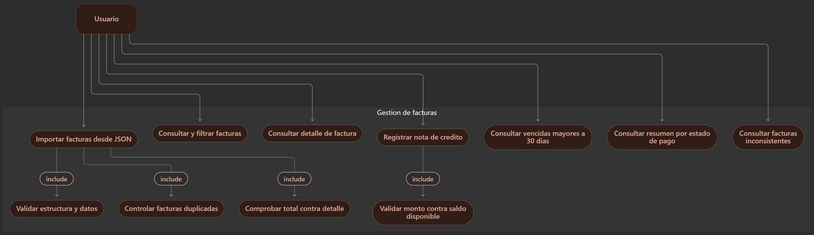
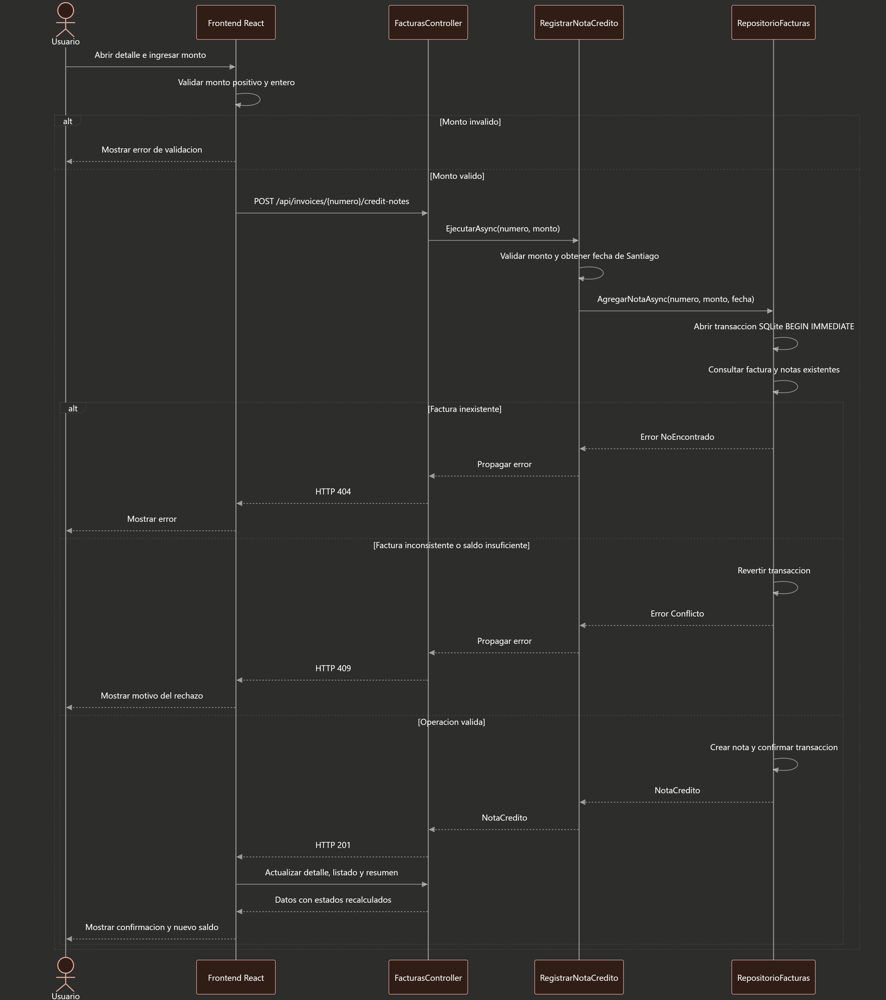
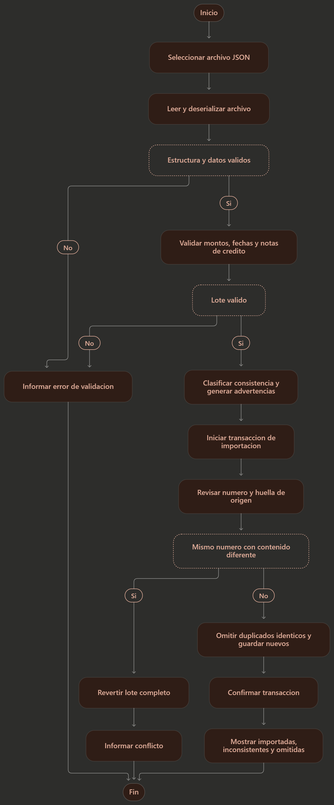
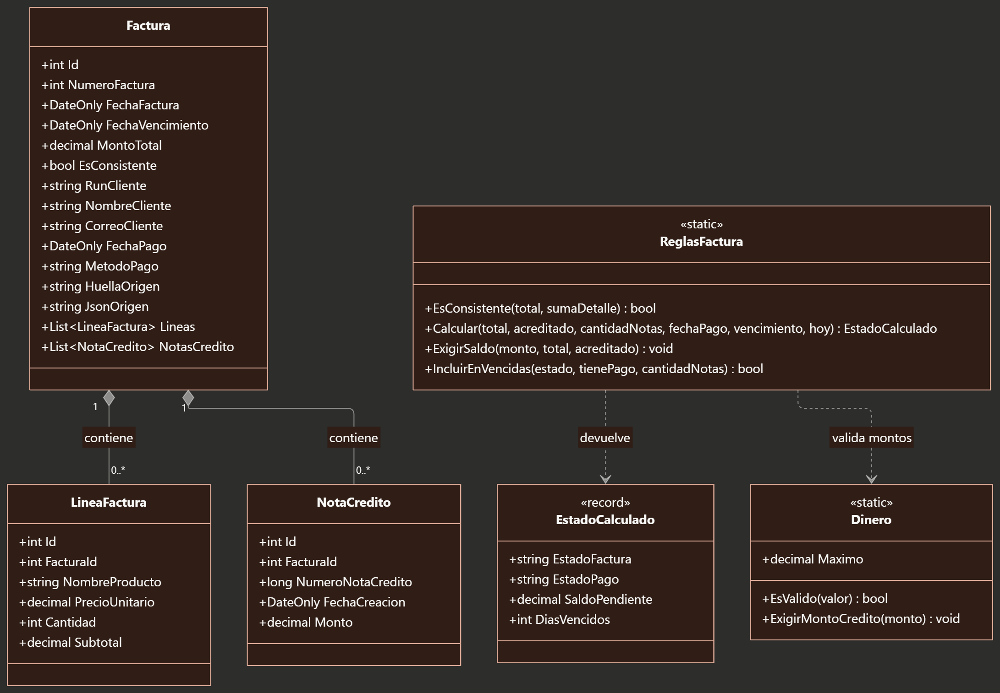
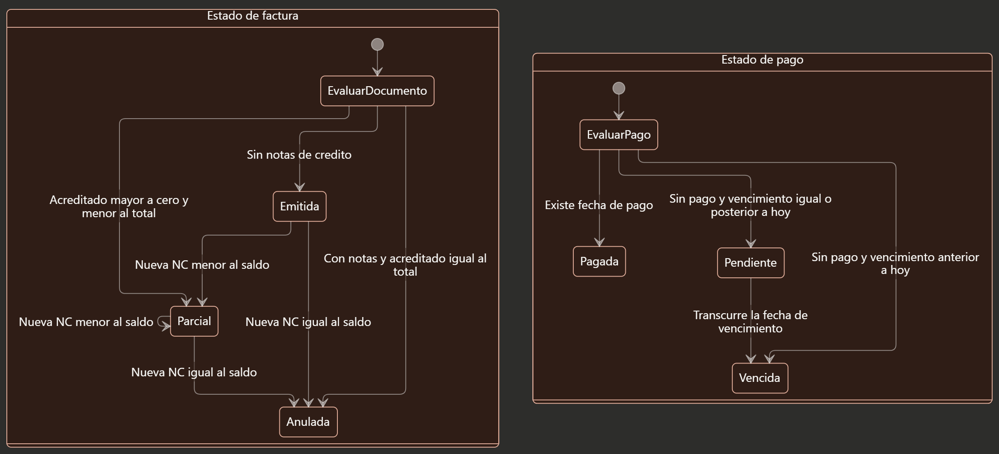

# Gestión de facturas

Aplicación para importar facturas desde JSON, consultar sus estados, registrar notas de crédito y generar reportes. Backend en .NET 8, EF Core y SQLite; frontend en React con Vite.


## Requisitos y ejecución

- .NET SDK 8.
- Node.js 22 o 24 y npm.

Desde la raíz del proyecto, en PowerShell:

```powershell
dotnet restore Eficiencia.sln
dotnet run --project backend/ApiFacturas
```

En otra terminal, desde la misma raíz:

```powershell
cd frontend
npm.cmd ci
npm.cmd run dev
```

Interfaz: http://localhost:5173.  Swagger: http://localhost:5080/swagger.

La API crea `eficiencia.db` y aplica las migraciones al iniciar.  
En la interfaz, selecciona **Importar JSON** y carga `data/bd_exam_invoices.json`:  
contiene 50 facturas, de las cuales 41 y 48 presentan diferencias de totales y quedan fuera del listado activo.

La configuración está en `backend/ApiFacturas/appsettings.json`.  
La conexión y la zona horaria pueden sobrescribirse con `ConnectionStrings__Facturas` y `ZonaNegocio`.  
Las dos terminales deben mantenerse abiertas. En Linux o macOS utiliza `npm` en lugar de `npm.cmd`.


## Arquitectura

El backend se organiza en `Api`, `Aplicacion`, `Dominio` e `Infraestructura`.  
Los controladores reciben HTTP, los casos de uso coordinan operaciones, el dominio concentra reglas y la infraestructura implementa JSON, reloj y persistencia. El frontend se divide por funcionalidades dentro de `src/features`.

Se utiliza **Facade** en `Aplicacion/Importacion/FachadaImportacion.cs`: ofrece una operación de importación y delega la lectura en `LectorFacturasJson`, la validación en `ValidadorImportacion` y el guardado en `RepositorioFacturas`.  
El repositorio es específico del módulo y permite aislar el acceso a datos en las pruebas.

Las vistas SQL agregan productos y NC por separado. Los estados se calculan en C# con un reloj sustituible; los filtros se aplican antes de paginar. Importación y creación de NC reservan la escritura en SQLite antes de leer los datos que van a validar.


## Reglas asumidas

- Montos en CLP enteros, hasta 1.000.000.000.000. Una NC debe ser positiva y no superar el total menos las NC anteriores.  
Una factura pagada también admite NC si conserva ese saldo.  

- La fecha de negocio usa `America/Santiago`.  
El pago registrado tiene prioridad; sin pago, una factura está vencida cuando su vencimiento es anterior a hoy.  

- Los estados del JSON se recalculan.  
Las diferencias entre total y suma de subtotales se conservan como inconsistencias.  

- Un documento de origen idéntico se omite al reimportar.  
El mismo número con contenido diferente produce conflicto y revierte el lote completo.  
Las NC creadas posteriormente se conservan.  

- El reporte de vencidas exige más de 30 días y ausencia tanto de pago como de NC.  
El resumen considera todas las facturas consistentes, incluidas las anuladas.  

- La fecha de una NC nueva la asigna el servidor.  
Su número se genera dentro de la transacción; las fechas y números importados se preservan.


## Pruebas

Desde la raíz:

```powershell
dotnet test Eficiencia.sln
npm.cmd --prefix frontend test
npm.cmd --prefix frontend run build
```

Para el recorrido funcional con API real y DOM simulado, compila primero el backend y detén otros servidores en los puertos 5080 y 5173:

```powershell
dotnet build Eficiencia.sln
node scripts/verificar_recorrido.cjs
```

Las pruebas utilizan bases temporales y no modifican la base de uso normal. El esquema SQL de referencia está en `scripts/esquema.sql`; no es necesario ejecutarlo manualmente.


## Alcance y limitaciones

Aplicación local sin autenticación. 
Importaciones de hasta 10 MB y 10.000 facturas.  
Las consultas cargan proyecciones en memoria; esta implementación no está dimensionada para volúmenes masivos.  
No incluye pagos parciales ni devoluciones porque el archivo no contiene importes de pago.


## Diagramas UML
####
#### Casos de uso


#### Secuencia


#### Actividad


#### Clase


#### Estado

